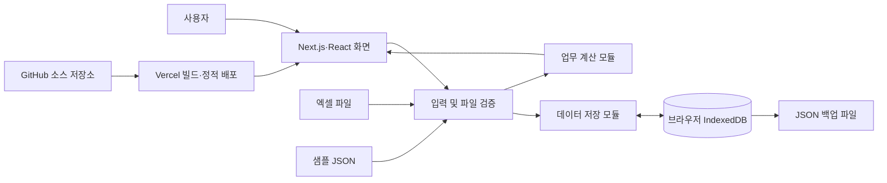

# 카페 운영관리 프로그램 기술 요구사항 문서(TRD)

- 문서 상태: MVP 기술 설계 확정본
- 작성일: 2026-10-12
- 기준 문서: `docs/01_PRD.md`, `docs/02_FRD.md`
- 참고 시안: `design/stitch_cafe_profit_management_dashboard`
- 배포 대상: GitHub 저장소와 Vercel

## 1. 문서 목적

이 문서는 PRD와 FRD에서 확정한 기능을 어떤 기술과 구조로 구현할지 정의한다. 기능 범위, 사용 순서, 계산식은 FRD를 그대로 따르며 이 문서에서 변경하지 않는다.

핵심 기술 원칙은 다음과 같다.

1. 매장 기록은 서버가 아니라 사용자의 브라우저에만 저장한다.
2. 엑셀 가져오기, 계산, JSON 백업·복원도 브라우저 안에서 처리한다.
3. Vercel은 프로그램의 HTML·CSS·JavaScript 등 정적 파일만 제공한다.
4. 원본 기록과 계산 결과를 분리하고, 같은 입력에는 항상 같은 결과가 나오게 한다.
5. 전체 교체 작업은 검사 완료 후 한 번에 반영하며 중간 상태를 남기지 않는다.

## 2. 확정 기술

### 2.1 기본 기술

| 영역 | 기술 | 선택 이유 |
|---|---|---|
| 웹 프레임워크 | Next.js 16.3.5 App Router | 현재 프로젝트에 설치되어 있고, 화면별 코드 분리와 Vercel 배포를 지원한다. |
| 화면 구성 | React 19.2.8 | 입력창, 표, 필터와 자동 갱신 화면을 구성한다. |
| 개발 언어 | TypeScript 5, `strict` 모드 | 데이터 항목과 계산 입력의 실수를 개발 단계에서 찾는다. |
| 스타일 | Tailwind CSS 4와 CSS 변수 | 시안의 색상·간격·글꼴 규칙을 일관되게 적용한다. |
| 아이콘 | Lucide React | 현재 설치된 패키지를 사용하고 외부 아이콘 서버에 연결하지 않는다. |
| 브라우저 저장소 | IndexedDB + Dexie | 수천 건의 기록을 표처럼 나누어 저장하고, 여러 자료를 한 번에 안전하게 교체할 수 있다. |
| 입력 검증 | Zod | 엑셀·JSON·화면 입력에 같은 검증 규칙을 적용한다. |
| 화면 입력 | React Hook Form + Zod 연결 모듈 | 오류를 입력칸 옆에 표시하고 불필요한 화면 갱신을 줄인다. |
| 엑셀 | ExcelJS | 브라우저에서 `.xlsx` 파일을 읽고 양식을 만들 수 있다. |
| 금액 계산 | decimal.js | 소수 재료단가를 계산할 때 컴퓨터의 소수점 오차를 막는다. |
| 날짜 계산 | date-fns | 월요일 시작 주, 월 시작·종료일을 일관되게 계산한다. |
| 차트 | Recharts | 대시보드 추이를 구현하되 표 형태의 대체 정보도 함께 제공한다. |
| 단위·통합 검사 | Vitest, Testing Library, fake-indexeddb | 계산, 입력창, 브라우저 저장소를 빠르게 검사한다. |
| 실제 사용 흐름 검사 | Playwright | 엑셀 가져오기부터 백업·복원까지 브라우저에서 검사한다. |

추가 패키지는 정확한 버전을 `package-lock.json`에 고정한다. Next.js가 요구하는 Node.js `20.9.0` 이상을 사용하고, GitHub와 Vercel은 같은 Node.js 주 버전을 사용한다.

### 2.2 지원 브라우저

Next.js 16의 기본 지원 범위에 맞춰 Chrome 111+, Edge 111+, Firefox 111+, Safari 16.4+를 지원한다. 실제 매장 운영의 우선 검사 대상은 최신 Chrome과 Edge 데스크톱 버전이다.

Internet Explorer와 오래된 모바일 브라우저는 지원하지 않는다. IndexedDB 또는 파일 읽기 기능을 사용할 수 없는 브라우저에서는 기능을 시작하지 않고 지원 브라우저를 안내한다.

## 3. 전체 구조



매장 기록은 `UI → 검증 → IndexedDB` 경로로만 움직인다. Vercel, GitHub 또는 외부 데이터베이스로 전송하지 않는다.

### 3.1 렌더링 방식

- 공통 레이아웃과 초기 안내는 Next.js 서버 컴포넌트가 빌드 시 정적 HTML로 만든다.
- IndexedDB, 파일 선택, 다운로드, 입력창처럼 브라우저 기능이 필요한 부분만 클라이언트 컴포넌트로 만든다.
- 브라우저 저장소 접근은 화면이 브라우저에서 실행된 뒤 시작한다. 빌드 중에는 `window`, `document`, IndexedDB를 참조하지 않는다.
- API Route, Route Handler, Server Action, 서버 데이터베이스는 만들지 않는다.
- 모든 화면은 빌드 시 정적으로 생성한다. `next.config.ts`에는 `output: "export"`를 사용하고 결과물은 `out` 폴더에 만든다.
- 정적 내보내기에서 지원하지 않는 쿠키, 동적 경로, 서버 요청 헤더, 서버 리다이렉트는 사용하지 않는다.

### 3.2 화면 경로

| 주소 | 화면 | 주요 FRD |
|---|---|---|
| `/` | 대시보드·손익 | FR-15~18 |
| `/sales` | 판매 기록 관리 | FR-02~04 |
| `/profitability` | 메뉴별 수익성 | FR-05~06 |
| `/inventory` | 재고 현황·흐름 | FR-09~14 |
| `/expenses` | 비용 기록 관리 | FR-07~08 |
| `/data` | 데이터 관리 | FR-19~24 |

모든 경로는 고정 경로다. 판매나 재고 입력창은 현재 화면 위에 표시하는 대화상자로 구현하며 별도 동적 주소를 만들지 않는다.

## 4. 권장 코드 구조

```text
src/
  app/
    layout.tsx                 공통 문서·상단 메뉴
    page.tsx                   대시보드
    sales/page.tsx
    profitability/page.tsx
    inventory/page.tsx
    expenses/page.tsx
    data/page.tsx
    error.tsx                  화면 오류 복구
    global-error.tsx           전체 앱 오류 복구
    not-found.tsx
    globals.css
  components/
    layout/                    상단 메뉴·공통 틀
    ui/                        버튼·입력·표·대화상자·상태표시
    charts/                    차트와 표 대체 정보
  features/
    sales/                     판매 화면·입력·목록
    profitability/             메뉴 수익성 화면
    inventory/                 재고 화면·입력
    expenses/                  비용 화면·입력
    dashboard/                 실적·예상 손익 화면
    data-management/           엑셀·백업·복원 화면
  domain/
    models/                    업무 데이터 TypeScript 형식
    calculations/              판매·수익성·손익·재고 계산
    validation/                업무 검증 규칙
    periods/                   일·주·월 범위 계산
  db/
    database.ts                IndexedDB 정의와 버전
    repositories/              자료별 조회·저장 함수
    migrations/                저장 형식 변경 절차
  files/
    excel/                     엑셀 읽기·열 이름 변환·오류 목록
    backup/                    JSON 생성·검증·복원
  hooks/                       화면용 데이터 구독과 상태
  lib/                         숫자·날짜·파일 공통 도구
public/
  sample/prep-cafe-v3.1.json   가상 샘플만 포함
  templates/cafe-operations-template-v1.xlsx
tests/
  unit/
  integration/
  e2e/
```

화면 컴포넌트에서 계산식을 직접 작성하지 않는다. 모든 계산은 `domain/calculations`의 순수 함수로 모아 화면, 엑셀 가져오기 검사, 자동 갱신과 검사 코드가 같은 기준을 사용하게 한다.

## 5. 브라우저 데이터베이스

### 5.1 IndexedDB를 사용하는 이유

제공된 JSON은 약 3.4MB이며 기록이 계속 늘어난다. `localStorage`는 저장 용량이 작고 전체 문자열을 한 번에 읽고 써야 하므로 사용하지 않는다. IndexedDB는 자료 종류별 저장, 조건 검색, 안전한 일괄 교체에 적합하다.

### 5.2 저장 표와 기본 키

| 저장 표 | 기본 키 | 주요 검색 기준 |
|---|---|---|
| `meta` | 고정 키 | 자료 버전·기준일 |
| `settings` | 설정 키 | 현재 설정 |
| `suppliers` | `supplierId` | 이름 |
| `materials` | `materialId` | 이름·공급사 ID |
| `menus` | `menuId` | 이름·분류 |
| `recipes` | 레시피버전+메뉴ID+재료ID+채널 | 메뉴·레시피버전 |
| `priceHistory` | 재료ID+적용시작일 | 재료·적용시작일 |
| `calendar` | 날짜 | 영업·마감 여부 |
| `sales` | `saleId` | 날짜·메뉴·채널, 날짜 범위 |
| `openingInventory` | 재료ID | 시작일 |
| `inventoryEvents` | `eventId` | 날짜·재료·유형 |
| `expenses` | `expenseId` | 날짜·비용항목 |
| `monthlyExpensePlan` | 월+비용항목 | 월 |

판매의 `날짜+메뉴ID+채널` 조합에는 중복 방지용 고유 인덱스를 둔다. 입력·수정·가져오기 모두 같은 제약을 적용한다.

새 기록 ID는 브라우저의 `crypto.randomUUID()`로 만든 뒤 종류별 접두사를 붙인다. 가져온 기존 ID는 그대로 보존한다.

### 5.3 저장 형식 원칙

- 필드명은 코드 내부에서 영문 `camelCase`를 사용하고, 엑셀·JSON 경계에서 원본 이름과 변환한다.
- 날짜는 시간대 변환이 없는 `YYYY-MM-DD` 문자열로 저장한다.
- 월은 `YYYY-MM`, 통화는 `KRW`, 금액은 VAT 제외 원 단위로 저장한다.
- 최종 금액은 정수 원으로 저장한다. 재료 단위원가의 중간 계산만 Decimal 값을 사용하고 FRD 시점에서 반올림한다.
- 빈칸은 `null` 또는 필드 없음으로 저장하고 0과 구분한다.
- 과거 판매의 당시 단가·원가·수수료 스냅샷은 수정 없이 보존한다.
- 계산으로 다시 만들 수 있는 대시보드 합계, 수익성 순위, 현재 잔량은 저장하지 않는다.

### 5.4 저장과 갱신

- 화면은 Dexie의 변경 구독을 사용해 저장 성공 후 관련 결과를 다시 읽는다.
- 한 기록의 저장·수정·삭제는 하나의 데이터베이스 거래 단위로 처리한다.
- 엑셀 가져오기, JSON 복원, 샘플 불러오기는 모든 표를 하나의 거래 단위로 교체한다.
- 처리 중 하나라도 실패하면 전체를 취소하여 이전 상태를 유지한다.
- 전체 자료에는 `schemaVersion`을 둔다. 저장 구조가 바뀌면 Dexie migration을 먼저 작성하고 이전 버전 자료로 회귀 검사를 한다.

## 6. 계산 모듈

### 6.1 불변 규칙

- FRD의 판매·수익성·실적·예상 손익·재고·발주 공식을 그대로 함수로 구현한다.
- 새 판매의 결제수수료는 실 결제금액의 1.5%이며 원 단위 반올림한다.
- 과거 판매는 파일에 저장된 수수료와 원가 스냅샷을 사용한다.
- 메뉴 수익성에는 공통 운영비를 배분하지 않는다.
- 실제 비용과 월 비용계획을 같은 날짜에 중복 합산하지 않는다.
- 미마감일의 입력 기록은 잠정 실적이고, 같은 날짜에 판매 예상을 다시 더하지 않는다.
- 최신 실사의 실측수량을 해당 일자의 마감 잔량 기준으로 사용한다.

### 6.2 함수 경계

| 모듈 | 입력 | 출력 |
|---|---|---|
| `calculateSaleSnapshot` | 메뉴·레시피·가격·채널·수량·실 결제금액 | 할인, 수수료, 개당·총 원가, 공헌이익 |
| `aggregateProfitability` | 기간 판매 목록·메뉴 | 메뉴·채널별 합계와 상태 |
| `calculateActualPnl` | 기간 판매·비용·마감 상태 | 확정·잠정 실적 손익 |
| `forecastPnl` | 최근 28개 마감 영업일, 남은 달력, 월 비용계획 | 예상 손익과 계산 근거 |
| `calculateInventory` | 초기재고·판매·재고 변동·레시피 | 재료별 현재 잔량 |
| `calculateReorderReference` | 현재 잔량·최근 사용량·납기·안전일·구매용량 | 부족 상태·참고 발주량 |

함수는 IndexedDB나 React를 직접 참조하지 않는다. 필요한 자료를 인수로 받아 결과만 반환해 검사하기 쉽게 만든다.

### 6.3 반올림과 날짜

- 모든 금액 계산은 Decimal로 수행하고 최종 원 단위에서 일반 반올림한다.
- 비율은 계산용 원값을 유지하고 화면에서만 소수점 첫째 자리로 표시한다.
- `0`으로 나누는 비율은 `null`을 반환하고 화면에 `계산 불가`로 표시한다.
- 주간 범위는 월요일 00시부터 일요일까지의 날짜 문자열로 만든다.
- 날짜 비교에 브라우저 UTC 변환을 사용하지 않아 한국 날짜가 하루 바뀌는 문제를 막는다.

## 7. 엑셀 가져오기와 양식

### 7.1 파일 처리 방식

- 엑셀 파일은 브라우저가 직접 읽으며 서버로 업로드하지 않는다.
- 데이터 관리 화면에 들어왔을 때만 ExcelJS를 동적으로 불러와 초기 화면 용량을 줄인다.
- `.xlsx`만 허용하며 암호화 파일, 매크로 파일, 손상 파일은 거부한다.
- 기본 파일 크기 상한은 10MB다. 제공 자료보다 충분히 크며 비정상적으로 큰 파일이 브라우저를 멈추는 것을 막는다.
- 수식 셀은 계산하지 않는다. 업무 데이터 영역에 수식이 있으면 값 변조와 해석 차이를 막기 위해 오류로 처리한다.

### 7.2 검사 단계

```text
파일 형식 확인
→ 필수 시트·열 확인
→ 셀 값을 내부 자료형으로 변환
→ 행 단위 형식 검사
→ ID 중복·연결 검사
→ 판매 중복·원가 계산 가능 여부 검사
→ 시트별 건수와 오류 목록 생성
→ 사용자 최종 확인
→ IndexedDB 전체 교체 거래
```

오류는 `{sheet, row, column, value, code, message}` 형태로 모은다. 오류가 하나라도 있으면 데이터베이스를 변경하지 않는다. 화면에는 사용자가 고칠 수 있는 한국어 설명을 표시한다.

### 7.3 엑셀 양식

- 정해진 시트와 열을 가진 버전 표시 파일을 `public/templates`에 둔다.
- 예시 행은 안내용 시트에 두거나 `예시`임을 명확히 표시해 실제 기록으로 읽히지 않게 한다.
- 양식 버전은 파일과 숨기지 않은 자료정보에 함께 표시한다.
- 실제 매장 기록이 들어간 엑셀은 GitHub `public` 폴더에 두지 않는다.

## 8. JSON 백업과 복원

### 8.1 백업 형식

```json
{
  "backupFormat": "cafe-operations-backup",
  "schemaVersion": 1,
  "createdAt": "ISO-8601 시각",
  "appVersion": "배포 버전",
  "data": {
    "meta": {},
    "settings": {},
    "suppliers": [],
    "materials": [],
    "menus": [],
    "recipes": [],
    "priceHistory": [],
    "calendar": [],
    "sales": [],
    "openingInventory": [],
    "inventoryEvents": [],
    "expenses": [],
    "monthlyExpensePlan": []
  }
}
```

- 백업은 IndexedDB의 한 시점 자료를 읽어 JSON Blob으로 만들고 사용자 기기에 내려받는다.
- 파일 생성 후 임시 Object URL을 즉시 해제한다.
- JSON은 평문이다. 암호화 백업은 MVP 범위가 아니므로 사용자가 안전한 위치에 보관해야 한다.

### 8.2 복원

- `backupFormat`, `schemaVersion`, 모든 자료 구조와 ID 연결을 Zod와 업무 검증기로 검사한다.
- 지원 가능한 이전 버전은 명시적 변환 함수를 거친다. 알 수 없는 미래 버전은 거부한다.
- 검증 통과 전에는 기존 자료를 지우지 않는다.
- 최종 확인 후 전체 표를 하나의 IndexedDB 거래로 교체한다.
- 실패하면 거래를 되돌리고 기존 자료와 현재 화면을 유지한다.

## 9. 개인정보와 보안

### 9.1 데이터가 머무는 위치

| 위치 | 포함 가능한 내용 |
|---|---|
| GitHub | 소스, 가상 샘플, 빈 엑셀 양식만 포함 |
| Vercel | 빌드된 프로그램 파일, 가상 샘플, 빈 양식만 포함 |
| 사용자 브라우저 | 실제 판매·비용·재고 기록 전체 |
| 사용자가 내려받은 파일 | 평문 JSON 백업 또는 사용자가 관리하는 엑셀 |

MVP에는 고객 이름, 전화번호, 결제카드 번호 등 고객 개인정보 입력란이 없다. 매장 운영 기록도 영업상 민감할 수 있으므로 다음 기준을 적용한다.

- 실제 운영 엑셀·JSON·백업 파일을 Git에 커밋하지 않는다.
- 저장소는 비공개 GitHub 저장소를 권장한다.
- `.gitignore`에 운영자료 파일명 패턴과 `backups/`, `imports/` 같은 로컬 폴더를 추가한다.
- 샘플 데이터에는 `가상 매장 샘플` 표시를 유지한다.
- 외부 분석도구, 광고 스크립트, 원격 오류 수집 도구를 넣지 않는다.
- 외부 폰트·이미지를 호출하지 않고 필요한 자산을 프로젝트에 포함한다.
- 사용자 입력을 `dangerouslySetInnerHTML`로 출력하지 않고 React의 기본 문자 이스케이프를 사용한다.
- 파일명과 화면 문자열을 HTML이나 실행 코드로 해석하지 않는다.

### 9.2 사용자가 알아야 할 한계

- 로그인과 앱 자체 암호화가 없으므로 같은 운영체제·브라우저 프로필을 쓰는 사람은 자료를 볼 수 있다.
- 브라우저 데이터 삭제, 시크릿 모드 종료, 기기 분실·고장 시 IndexedDB 자료가 사라질 수 있다.
- JSON 백업 파일은 암호화되지 않으므로 공유 폴더나 공개 저장소에 올리면 안 된다.
- Vercel 미리보기 주소와 운영 주소는 서로 다른 웹사이트 주소이므로 브라우저 저장소도 서로 분리된다.
- 도메인이 바뀌면 기존 자료가 자동 이동하지 않는다. 사용자가 JSON 백업·복원으로 옮겨야 한다.
- 코드 배포를 되돌려도 브라우저의 운영자료가 자동으로 과거 상태로 돌아가지는 않는다.

### 9.3 웹 보안 설정

정적 내보내기에서는 Next.js의 동적 응답 헤더를 사용할 수 없으므로 Vercel 설정 파일에서 다음 보안 헤더를 적용한다.

- `Content-Security-Policy`: 프로젝트 자체 파일만 허용하고 객체·프레임 삽입을 차단한다.
- `X-Content-Type-Options: nosniff`
- `Referrer-Policy: strict-origin-when-cross-origin`
- `Permissions-Policy`: 카메라, 마이크, 위치정보 등 사용하지 않는 권한을 차단한다.
- `frame-ancestors 'none'`: 다른 사이트가 화면을 끼워 넣지 못하게 한다.

Next.js 실행에 필요한 자체 인라인 스크립트와 Tailwind 스타일 범위를 검증한 뒤 가능한 좁은 CSP를 사용한다. 외부 도메인은 허용 목록에 추가하지 않는다.

### 9.4 의존성과 저장소 보호

- `package-lock.json`을 커밋하고 배포에서는 `npm ci`를 사용한다.
- Dependabot을 주 1회 실행하고 높은 위험도 취약점은 배포 전에 검토한다.
- GitHub Actions 권한은 소스 읽기와 검사 결과 작성에 필요한 최소 범위로 둔다.
- 비밀값은 MVP에 필요하지 않다. 향후 생기더라도 소스와 `NEXT_PUBLIC_` 변수에 비밀값을 넣지 않는다.
- 실제 운영자료를 검사 자료로 사용하지 않고 작은 가상 fixture를 사용한다.

## 10. 처리 속도와 용량

### 10.1 목표

제공된 샘플 규모를 기준으로 최신 보급형 업무용 노트북과 지원 브라우저에서 다음을 목표로 한다.

| 작업 | 목표 |
|---|---:|
| 정적 화면 첫 표시 | 2.5초 이내 |
| IndexedDB 열기와 샘플 규모 자료 준비 | 1.5초 이내 |
| 일·주·월 필터 및 집계 | 300ms 이내 |
| 판매·비용·재고 한 건 저장 후 화면 갱신 | 500ms 이내 |
| 제공된 약 0.5MB 엑셀 검사·가져오기 | 5초 이내 |
| 약 3.5MB JSON 백업·복원 | 5초 이내 |

성능 측정 중에도 버튼을 여러 번 누르지 않게 처리 중 상태를 표시한다. 1초가 넘는 작업에는 진행 중임을 알리는 문구를 제공한다.

### 10.2 최적화 방법

- 날짜·메뉴·채널·재료에 IndexedDB 인덱스를 둬 필요한 기록만 읽는다.
- 판매 목록은 한 페이지에 50건만 그린다.
- 집계는 필터와 데이터 변경번호를 기준으로 메모하여 같은 계산을 반복하지 않는다.
- ExcelJS와 백업 화면 전용 코드는 데이터 관리 경로에서만 동적으로 불러온다.
- 가상 샘플 JSON은 사용자가 샘플 불러오기를 선택할 때만 내려받는다.
- 차트에는 화면에 필요한 집계점만 전달하고 원본 수천 행을 직접 넘기지 않는다.
- 대량 검증은 일정 행 수마다 브라우저에 제어를 돌려 입력 화면이 완전히 멈추지 않게 한다.
- 초기 JavaScript와 화면별 묶음 크기를 빌드 때 확인한다.

## 11. 비용 검토

### 11.1 MVP 운영 비용 구조

- 서버 데이터베이스, 인증 서비스, 파일 저장소, API 서버가 없어 해당 월 사용료가 없다.
- Vercel은 정적 파일 제공과 Git 연동 빌드만 담당한다.
- GitHub는 소스와 문서를 보관한다.
- 실제 비용은 선택한 GitHub·Vercel 요금제, 빌드 횟수, 전송량, 사용자 도메인 구매 여부에 따라 달라진다.
- 매장 기록이 늘어도 서버 저장 비용은 늘지 않지만 사용자 기기의 브라우저 저장공간을 사용한다.

### 11.2 비용 증가 요인

- 큰 샘플 또는 이미지 파일을 모든 방문자에게 자동 전송하는 경우
- 필요 이상의 잦은 커밋으로 Vercel 빌드가 반복되는 경우
- 향후 로그인, 여러 기기 동기화, 클라우드 백업을 추가하는 경우
- 외부 오류 수집·분석·데이터베이스 서비스를 추가하는 경우

현재 MVP에서는 이미지와 샘플을 지연 로딩하고, 기능 브랜치의 검사 통과 후 병합해 불필요한 운영 배포를 줄인다.

## 12. 오류 처리와 복구

### 12.1 오류 분류

| 분류 | 예 | 처리 방식 |
|---|---|---|
| 예상 가능한 입력 오류 | 필수값 누락, 중복 판매, 음수 수량 | 예외를 던지지 않고 오류 코드와 한국어 메시지를 반환해 입력칸에 표시 |
| 파일 오류 | 시트 누락, 잘못된 ID, 손상 JSON | 기존 자료를 유지하고 오류 위치·이유 표시 |
| 저장 오류 | 용량 부족, IndexedDB 차단 | 거래 취소, 성공 표시 금지, 입력값 유지와 백업 안내 |
| 계산 불가 | 가격·레시피·달력·비용계획 부족 | 임의 숫자를 만들지 않고 `계산 불가`와 필요한 자료 표시 |
| 예상 밖 프로그램 오류 | 화면 렌더링 또는 코드 오류 | 가까운 `error.tsx`에서 화면 복구와 다시 시도 제공 |
| 앱 전체 오류 | 공통 레이아웃 오류 | `global-error.tsx`에서 최소 복구 화면 제공 |

### 12.2 오류 결과 형식

업무 함수와 저장 함수는 예상 오류를 다음 형식으로 반환한다.

```ts
type Result<T> =
  | { ok: true; value: T }
  | {
      ok: false;
      code: string;
      message: string;
      fieldErrors?: Record<string, string>;
    };
```

화면 이벤트에서 발생하는 파일·IndexedDB 오류는 직접 잡아 사용자에게 알린다. 운영 콘솔에 실제 매출, 비용, 파일 내용 전체를 출력하지 않는다. 오류 기록이 필요하면 코드, 발생 위치, 앱 버전만 남긴다.

### 12.3 안전한 전체 교체

엑셀 가져오기·JSON 복원·샘플 교체는 다음 순서를 반드시 지킨다.

1. 임시 메모리에서 파일을 읽는다.
2. 형식과 업무 연결을 모두 검사한다.
3. 교체 건수와 영향을 사용자에게 보여준다.
4. 확인 후 하나의 IndexedDB 거래로 전체를 교체한다.
5. 새 자료를 다시 읽어 기본 건수와 ID 연결을 확인한다.
6. 실패 시 거래를 취소하고 기존 자료를 그대로 사용한다.

## 13. 화면 구현 기준

### 13.1 시안 반영

- `DESIGN.md`의 Espresso Ledger 색상, 표 밀도, 상태 색상, 숫자 정렬을 CSS 변수와 Tailwind 테마로 옮긴다.
- 시안의 데스크톱 구성을 기준으로 태블릿은 표 가로 스크롤, 모바일은 요약 카드와 하단 저장 버튼으로 바꾼다.
- 시안에 있지만 FRD에서 제외한 기능은 비활성 버튼으로 남기지 않고 제거한다.
- 원격 이미지 주소와 가짜 사용자·지점 선택 기능은 사용하지 않는다.
- 확정·잠정·예상·부족 상태는 글자와 아이콘을 함께 사용한다.

### 13.2 접근성

- 모든 입력은 보이는 라벨과 연결한다.
- 대화상자를 열면 첫 입력으로 초점을 옮기고 닫으면 실행 버튼으로 되돌린다.
- 키보드만으로 메뉴, 표 행 작업, 입력, 확인·취소를 사용할 수 있게 한다.
- 저장·오류 결과는 `aria-live` 영역에서 읽히게 한다.
- 색상만으로 손익·부족·예상 상태를 구분하지 않는다.
- 차트의 핵심 수치를 제목과 표 또는 설명문으로 함께 제공한다.
- 위험한 삭제·복원 버튼은 일반 저장 버튼과 시각·문구로 구분한다.

## 14. 검사 전략

### 14.1 단위 검사

- 판매 정상가격, 할인, 1.5% 수수료, 원가, 공헌이익과 반올림
- 매장·포장 레시피 차이
- 0원 판매와 계산 불가 비율
- 확정·잠정·예상 손익 및 비용 중복 방지
- 최근 28개 마감 영업일 예상
- 실사 기준 잔량, 폐기, 음수 재고, 안전 목표량과 구매용량 올림
- 일·월요일 시작 주·월 기간과 한국 날짜 처리

### 14.2 통합 검사

- Dexie 저장·수정·삭제와 관련 화면 자동 갱신
- 중복 판매 고유 인덱스
- 엑셀 전체 검사 성공·실패와 원자적 교체
- JSON 백업 후 복원 결과의 완전 일치
- 저장 실패 시 기존 자료 유지
- 저장 형식 버전 migration

### 14.3 브라우저 흐름 검사

Playwright로 FRD 14장의 13개 완료 시나리오를 검사한다. 특히 다음 연결을 하나의 흐름으로 확인한다.

```text
판매 입력
→ 메뉴 공헌이익 변화
→ 기간 손익 변화
→ 레시피 재료 잔량 감소
→ 부족 상태와 참고 발주량 변화
```

Chrome 계열 전체 검사를 필수로 하고 Firefox와 WebKit은 핵심 흐름을 검사한다. 시안의 네 화면은 주요 해상도에서 시각 회귀 검사를 한다.

## 15. GitHub와 Vercel 배포

### 15.1 GitHub 작업 방식

- `main`은 배포 가능한 코드만 둔다.
- 기능별 브랜치에서 작업하고 Pull Request로 병합한다.
- 커밋에는 소스, 문서, 가상 검사자료와 잠금파일만 포함한다.
- 실제 엑셀, 실제 JSON 백업, `.env*`, `.vercel`, 빌드 결과는 커밋하지 않는다.

Pull Request의 필수 검사는 다음 순서다.

```text
npm ci
npm run lint
npm run typecheck
npm run test
npm run build
```

`package.json`에 `typecheck`, `test`, `test:e2e` 스크립트를 추가한다. 전체 브라우저 검사는 별도 작업으로 실행하고 핵심 계산·빌드 실패는 병합을 막는다.

### 15.2 Vercel 배포 흐름

1. 비공개 GitHub 저장소를 Vercel 프로젝트에 연결한다.
2. Vercel은 Next.js를 감지하고 `npm run build`를 실행한다.
3. Pull Request와 `main` 이외 브랜치는 고유한 Preview 주소로 배포한다.
4. Preview에서 가상 데이터로 핵심 흐름을 검사한다.
5. `main` 병합이 성공하면 Production 주소로 배포한다.
6. 배포 문제는 이전 정상 배포로 코드를 되돌리되, 사용자 브라우저 자료 복구는 JSON 백업을 사용한다.

Vercel Preview와 Production은 출처 주소가 달라 IndexedDB를 공유하지 않는다. Preview에는 실제 운영자료를 넣지 않는다.

### 15.3 배포 전 점검

- `npm run build`가 정적 내보내기를 성공하고 서버 기능이 섞이지 않았는지 확인한다.
- 모든 경로를 직접 열고 새로고침해 404가 발생하지 않는지 확인한다.
- 가상 샘플과 빈 엑셀 양식만 `out`에 포함되었는지 확인한다.
- 보안 헤더, CSP, 캐시 설정과 외부 네트워크 요청이 없는지 확인한다.
- 최신 Chrome·Edge에서 IndexedDB 저장, 다운로드, 복원을 확인한다.
- 실제 포함 기간, 확정·잠정·예상 표시, VAT 제외 문구를 확인한다.
- Lighthouse와 번들 분석으로 초기 속도와 큰 의존성을 확인한다.

## 16. 구현 순서

1. 업무 자료형, Zod 검증, Decimal 계산 함수와 단위 검사를 만든다.
2. IndexedDB 표·인덱스·저장소 함수와 가상 데이터 초기화를 만든다.
3. 공통 레이아웃, 디자인 토큰, 기간 선택, 표와 대화상자를 만든다.
4. 판매 입력·목록을 구현하고 수익성·손익·재고 연결을 완성한다.
5. 비용과 재고 입고·폐기·실사 CRUD를 연결한다.
6. 대시보드, 수익성, 재고 집계를 시안에 맞춰 표시한다.
7. 엑셀 양식·가져오기와 JSON 백업·복원을 구현한다.
8. 오류 경계, 접근성, 성능 최적화와 전체 흐름 검사를 수행한다.
9. GitHub 검사와 Vercel Preview를 통과한 뒤 Production에 배포한다.

## 17. 기술 완료 조건

- FRD의 FR-01~FR-24가 화면·도메인·저장 계층에 빠짐없이 연결된다.
- 제공 데이터 규모에서 10장의 속도 목표를 충족한다.
- 판매 입력 한 건이 수익성, 손익, 재고에 같은 거래 기준으로 반영된다.
- 엑셀·JSON의 잘못된 파일이 기존 IndexedDB 자료를 일부라도 바꾸지 않는다.
- 새로고침 후 자료가 유지되고 JSON 백업·복원 전후 데이터가 일치한다.
- 운영자료가 GitHub, Vercel, 외부 분석·오류 서비스로 전송되지 않는다.
- `lint`, TypeScript 검사, 단위·통합 검사, Next.js 정적 빌드가 통과한다.
- Chrome·Edge의 FRD 완료 시나리오와 핵심 Firefox·Safari 계열 흐름이 통과한다.
- Vercel Preview와 Production에서 정적 경로, 파일 다운로드, IndexedDB 기능이 정상 작동한다.

## 18. 참고한 현재 프로젝트 기준

- 설치된 Next.js: 16.3.5
- 설치된 React: 19.2.8
- 설치된 Tailwind CSS: 4.x
- Next.js 16.3.5 최소 Node.js: 20.9.0
- 로컬 공식 가이드: App Router 프로젝트 구조, 서버·클라이언트 컴포넌트, 오류 처리, 정적 내보내기, 데이터 보안, 운영 점검, 테스트, 지원 브라우저
- 배포 기준: GitHub 연동 Vercel Preview 및 Production 배포
