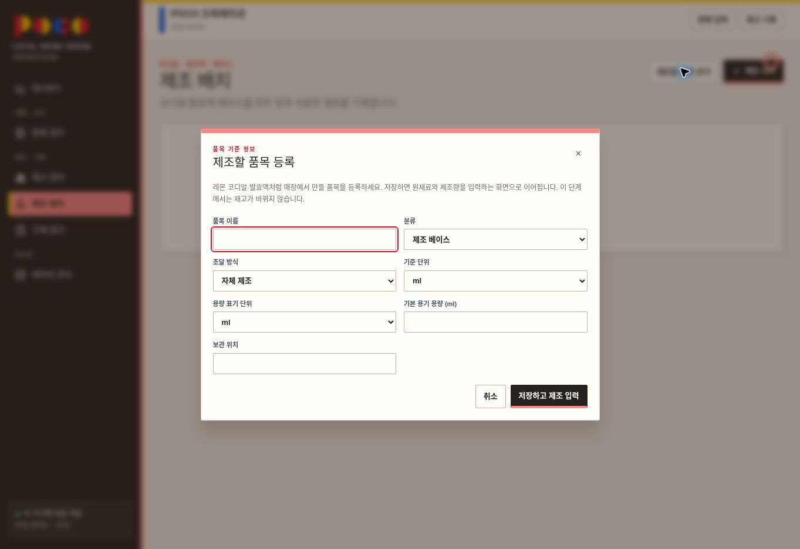

# 제조 배치 시작 흐름 개선 — 검토 대기

## 목적
제조할 품목이 없을 때 안내문에서 막히지 않고, 같은 화면에서 품목 등록 후 제조 입력으로 이어진다.

## 현재 문제
‘제조 시작’을 누르면 ‘품목 설정에서 조달 방식을 자체 제조로 설정’이라는 파란 안내만 표시되어 등록 위치와 다음 행동을 알기 어렵다.

## 변경 범위
BatchManager의 초기 안내·등록 연결·입력 도움말과 MaterialEditor의 제조 품목 등록 모드, 반응형 안내 카드 스타일.

## 유지 조건
일반 품목 등록·수정 화면과 기존 배치 데이터 구조, 원재료 차감 및 완성품 증가 규칙을 유지한다.

## 구현 요구 및 반영 사항
- 제조 품목이 없으면 단계 안내와 ‘제조할 품목 등록’ 버튼 표시.
- 제조 품목 등록은 자체 제조 및 제조 베이스 분류를 기본 선택. 분류는 변경 가능.
- 브랜드·안전/목표 재고 등의 부가 설정을 초기 제조 등록에서 생략. 이후 품목·재고에서 편집 가능.
- 저장 후 새 품목을 선택한 제조 입력 화면으로 바로 연결.
- 이미 제조 품목이 있어도 ‘제조할 품목 추가’ 버튼 제공.
- 생산량·투입량 옆 단위 표시, 원재료 등록·입고 위치 연결.
- 자기 자신을 투입 원재료로 선택하지 않도록 제한.
- 오류를 제조 입력창 안에 표시, 저장 중 중복 제출 방지, 대화상자 키보드 초점 관리.
- 작성 권한 없는 사용자의 등록·제조 버튼 숨김. 백엔드 권한 정책은 변경하지 않음.

## 데이터 영향과 복구
DB 스키마·마이그레이션 없음. 화면 진입과 입력창 열기는 데이터를 저장하지 않음. 사용자가 품목 저장 시 품목 마스터와 감사 기록만 추가하며, 제조 기록 저장은 기존 규칙대로 재고에 반영함. 실제 운영 데이터는 변경하지 않았음.
배포 전 검토 단계이며 GitHub main에 반영하지 않음. 이후 배포 시 문제가 생기면 이전 main 커밋 3eb59541efcd00b9cb0a1497ed2627cc8c6d1095의 코드로 되돌릴 수 있음. 코드 복구는 이후 사용자가 입력한 운영 기록을 되돌리는 작업과 별개임.

## 테스트
- TypeScript 검사 및 최종 Next.js 빌드 통과.
- ESLint 통과.
- 기존 Vitest 58개 통과, 기존 TODO 3개 유지.
- 클라우드와 연결하지 않은 로컬 검토 화면에서 실제 버튼 조작: 최초 안내 → 품목 등록 → ‘검토용 레몬 코디얼’ 등록 → 새 품목 자동 선택한 제조 입력창으로 연결 확인.
- 투입 원재료 미입력 시 입력창 내 오류 표시 확인. 검토 과정에서 제조 배치는 저장하지 않음.
- 최종 간소화 등록 화면 및 ‘제조할 품목 추가’ 버튼 확인.
- 모바일 반응형 CSS 구현. 모바일 기기 실측, 운영 환경 제조 저장 및 완성 전환은 이번에 검증하지 않음.

## 완료 기준과 상태
구현 및 로컬 데스크톱 흐름 검증 완료. 사용자 화면 검토 대기. GitHub main 동기화와 배포는 아직 하지 않았음.

