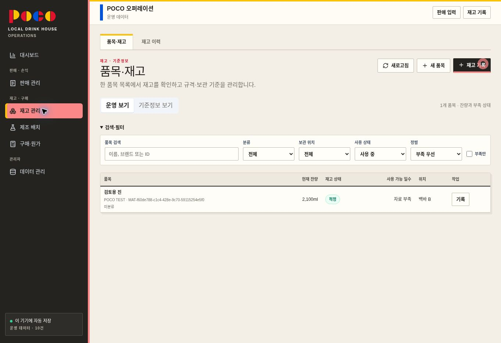
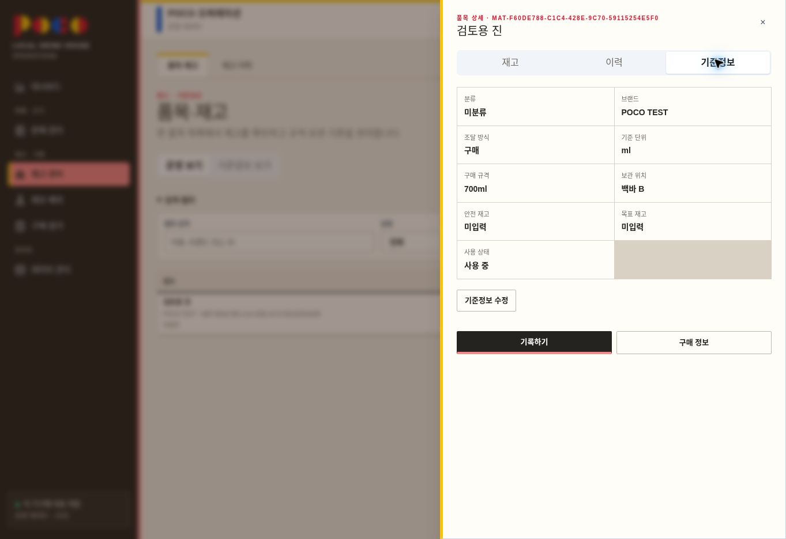

# POCO 품목·재고 통합 — 배포 전 검토본

상태: 구현 및 로컬 데스크톱 검증 완료 / 사용자 검토 대기 / 배포하지 않음.

## 기준과 변경 범위

- 저장소: https://github.com/yongza2026/AI-class
- 운영 배포에서 확인한 기준 커밋: `4baacbf33b15a4a404dd37285edd301cafe21d72` (`main`).
- 작업 브랜치: `feat/inventory-workspace-review` (로컬 전용, 원격 푸시 없음).
- 기존 3탭을 `품목·재고 / 재고 이력`으로 정리했다.
- 동일한 품목 목록에서 `운영 보기 / 기준정보 보기`를 전환한다. 검색·분류·위치·사용 상태·부족 여부·정렬을 공유한다.
- 품목 상세 우측 패널에 `재고 / 이력 / 기준정보` 탭을 제공하고 기록·수정을 연결했다.
- 새 품목 등록은 입고 이벤트를 만들지 않는다. 최초 입고는 별도 기록한다.
- `/inventory/items/`의 기존 검색·edit·return 링크는 통합 화면에 호환 연결한다.
- 기존 판매·구매·원가·제조·재고 이력 저장 모델과 DB 스키마는 유지했다.

## 같이 수정한 오류

1. 미분류 품목 수정 시 ‘주류’ 기본값으로 표시·저장될 가능성을 제거했다. 미설정 분류를 그대로 보존한다.
2. 검색 직후 보기 전환 시 비동기 URL 갱신이 충돌하는 문제를 브라우저에서 확인하고, 동기적인 History API 처리로 수정했다.
3. 저장 중 중복 제출을 차단하고, 저장이 끝난 후 요약 새로고침 실패를 저장 실패로 오인하지 않게 했다.
4. 포장 규격을 새로 저장할 때 L·kg를 기준 단위로 환산하며, 기존 규격이 그대로이면 기존 packQuantity를 유지한다. 구매 포장 입고 시 병별 잔량도 기준 수량으로 저장한다.
5. 이력이 연결된 기준 단위 변경을 차단하고 안전·목표 재고 및 단위 오류를 검증한다.
6. 모달 포커스 이동·순환·닫기 후 복귀와 키보드 상세 탭 이동을 추가했다.

## 검증 결과

| 구분 | 결과 | 근거 |
|---|---|---|
| TypeScript | 통과 | npm run typecheck |
| 린트 | 통과 | npm run lint |
| 단위·도메인 테스트 | 58개 통과, 기존 todo 3개 | npm test, 테스트 파일 9개 |
| 정적 빌드 | 통과 | npm run build, 정적 경로 17개 생성 |
| 빈 목록 → 새 품목 저장 | 로컬 브라우저 통과 | 검토용 진 등록, 잔량 0ml 확인 |
| 700ml × 3병 입고 | 로컬 브라우저 통과 | 2,100ml 미리보기 및 저장 후 목록·이력 반영 |
| 미분류 보존 | 로컬 브라우저 통과 | 위치를 백바 A→B로 수정해도 미분류·2,100ml 유지 |
| 이력 있는 단위 변경 차단 | 로컬 브라우저 통과 | ml→g 저장 거부, 입력 유지, 취소 후 ml 유지 |
| 검색·보기 전환 | 로컬 브라우저 통과 | 브랜드 검색 후 보기 전환 시 q·view 유지 |
| 상세 닫기 | 로컬 브라우저 통과 | 원래 검색 목록과 상세 열기 버튼으로 포커스 복귀 |
| 기존 품목 링크 | 로컬 브라우저 통과 | /inventory/items/?edit=…&q=…&return=… → 수정창, 취소 후 return 복귀 |
| 모바일 | 구현, 실기 검증 미완료 | 600px 이하 카드 목록·전체 화면 모달 CSS. 검토 브라우저 에뮬레이션 사용 불가 |
| 운영 권한·네트워크 저장 실패 | 운영 검증 미수행 | 운영 DB에 연결하지 않음. 기존 서버 권한 로직 유지 |
| Playwright 자동 E2E | 실행하지 않음 | 이번 브라우저 검증은 별도 로컬 브라우저에서 직접 수행. 기존 E2E 상세 버튼 선택자만 새 UI에 맞게 갱신 |

모든 쓰기 시험은 운영 사이트와 다른 로컬 원점에서 새로 만든 가상 품목으로 수행했다. 운영 DB 환경변수·키를 내려받지 않았고, 운영 자료 생성·수정·삭제, 마이그레이션, 원격 푸시 및 Vercel 배포를 실행하지 않았다.

화면에 ‘운영 데이터’로 보이는 것은 빈 매장의 로컬 등록 흐름이 사용하는 기본 표기다. 캡처의 ‘검토용 진 / POCO TEST’는 이번 검증에서 만든 가상 자료다.

추가적인 로컬 샘플 전체 교체는 자동 승인 검토가 데이터 유실 가능성으로 차단했다. 확인창을 취소했으며 기존 가상 품목을 유지했다.

## 검토 화면

## 사용자 검토 항목

- 운영 보기와 기준정보 보기의 구분·명칭이 직관적인가?
- 재고 목록의 잔량·상태·위치·기록 버튼이 영업 중 사용하기에 충분한가?
- 품목 상세의 재고·이력·기준정보 탭 및 수정·기록 흐름이 편리한가?
- 모바일/태블릿 실기 검증은 배포 승인 전 추가 확인 대상으로 남긴다.

## 복구 및 배포 조건

이번에는 로컬 코드만 변경했으므로 운영 복구 작업이 필요하지 않다. 변경을 사용하지 않으려면 기준 커밋을 계속 사용하면 된다. 작업본은 별도 브랜치로 보존한다.

사용자 검토와 명시적인 배포 승인 전에는 push·merge·Vercel 배포를 실행하지 않는다. 승인 후에도 최신 main과 충돌 여부 및 자동 배포 설정을 재확인하고, 운영 데이터 백업·복구 절차를 확인한 뒤 별도로 진행한다.

기존 전체 데이터셋 교체 방식의 동시 편집 충돌 문제와 계산 엔진 전면 개편은 이번 UI 통합 범위에 포함하지 않았다.
